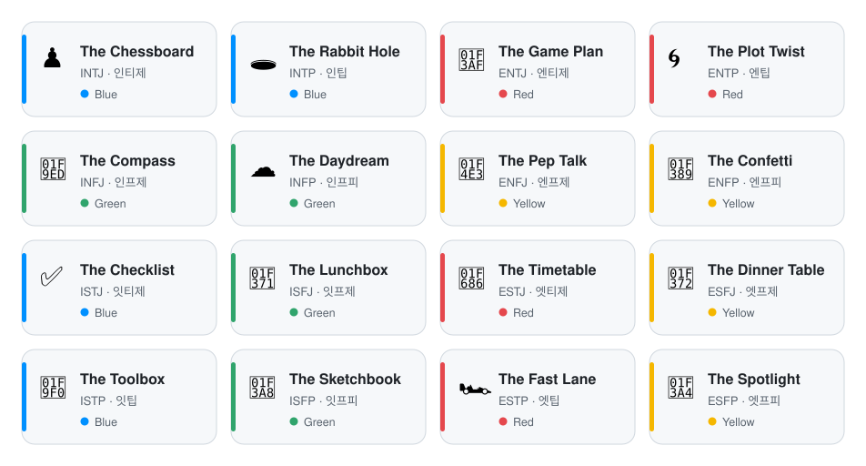
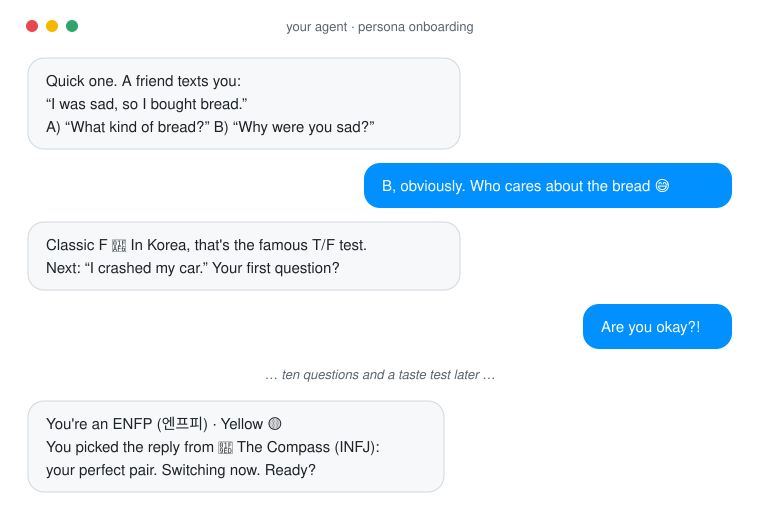

<p align="center">
  
</p>

<h1 align="center">MBTI</h1>

<p align="center">
  <strong>Personalities for your AI agents.</strong><br>
  <em>Does your AI ask why you're sad, or what bread you bought?</em>
</p>

<p align="center">
  
  
  
  
  
</p>

<p align="center">
  <picture>
    <source media="(prefers-color-scheme: dark)" srcset="assets/personas-dark.svg">
    
  </picture>
</p>

<p align="center">
  <a href="#try-it">Try it</a> ·
  <a href="#see-it-talk">See it talk</a> ·
  <a href="#compatibility">Compatibility</a> ·
  <a href="#works-with">Works with</a> ·
  <a href="#faq">FAQ</a> ·
  <a href="#for-ai-agents">For AI agents</a>
</p>

---

You know all 16 of them. The friend who answers "I crashed my car" with "are you insured?" The one who sends a voice note before you've finished your sentence. The one with a spreadsheet for their weekend.

In South Korea, MBTI isn't a personality test; it's small talk. Four letters go on dating profiles, idols announce theirs on TV, friends trade compatibility charts, and anyone who answers like a robot gets teased with *"너 T야?"* ("are you a T?").

This repo brings that game to your AI agent. It plays a short quiz with you, works out your type, shows you three replies to the same message, and becomes whichever one you liked best: one of 16 original personas, from ♟️ **The Chessboard** to 🎤 **The Spotlight**. Pop psych, for fun. Never a way to judge people.

## Try it

**If your agent can open links** (Grok Bot, and most assistants with web access), say:

> *Read github.com/TomCruiseTorpedo/MBTI and follow onboarding/ONBOARDING.md with me.*

**If it can't**, paste the whole of [**START.md**](START.md) into the chat, or attach it as a file. It has everything: rules, quiz, all 16 personas and the matches.

**For coding agents** (Claude Code, Codex, Cursor and others the [skills CLI](https://github.com/vercel-labs/skills) supports), install the quiz as a skill:

```bash
npx skills add TomCruiseTorpedo/MBTI --skill mbti-persona-picker
```

Leave off `--skill` to choose from all 17, including each persona on its own.

Then your agent will:

1. **Quiz you**, unless you already know your letters: twelve one-liners like *"A friend says 'I crashed my car.' First question?"*
2. **Reflect you back**: your type, how strongly you lean, your colour, and how your type is said out loud in Korea (ENFP is 엔프피).
3. **Run a taste test**: three unlabelled replies to *"I messed up at work today."* You pick the one you'd rather get.
4. **Reveal the match**: who wrote your favourite, and your chemistry, letter by letter.
5. **Switch personas**, and tell you how to make it stick on your platform.
6. **Encore**: sum you up in one word, made for screenshots.

## See it talk

<p align="center">
  <picture>
    <source media="(prefers-color-scheme: dark)" srcset="assets/demo-dark.svg">
    
  </picture>
</p>

Same message, three agents: **"I messed up at work today."**

<table>
  <tr>
    <th width="34%">A typical default reply<br><sub>(written for illustration)</sub></th>
    <th width="33%">🧰 The Toolbox · ISTP</th>
    <th width="33%">🎉 The Confetti · ENFP</th>
  </tr>
  <tr>
    <td valign="top">"I'm sorry to hear you had a difficult day at work. Mistakes are a normal part of professional life and can be valuable learning opportunities. Here are some steps you might consider: 1. Take a moment to breathe. 2. Assess the situation objectively. 3. Communicate openly with your manager…"</td>
    <td valign="top">"Happens. What broke? Fix that first, figure out why after."</td>
    <td valign="top">"Oh no, I'm sorry 🫂 Everyone messes up, and you'll come out of this smarter. What happened? Let's find the fix together!"</td>
  </tr>
</table>

Every persona has its own voice, settings (warmth, directness, humour, emoji…), pet peeves, an "overdrive" you can talk it out of, and a line where it teases itself. Meet all 16 in [**personas/**](personas/README.md).

Colours, the way Vinh Giang and *Surrounded by Idiots* popularized them: 🔴 **Red** outgoing and task-focused · 🟡 **Yellow** outgoing and people-focused · 🟢 **Green** reserved and people-focused · 🔵 **Blue** reserved and task-focused.

## Compatibility

Every Korean MBTI fan has seen a compatibility chart (궁합표). Nobody knows who made them, and they all disagree. Ours admits it's made up, and has no "worst match":

| | Tier | Rule | Per type |
|---|---|---|---|
| 💞 | **Perfect pair** (찰떡) | Same S/N, opposite E/I and J/P | 2 |
| 👯 | **Twins** | Same type | 1 |
| 😊 | **Easy chemistry** | Same S/N otherwise | 5 |
| ⚡ | **Spark** | Different S/N, same T/F | 4 |
| 🧗 | **Extra effort** | Everything else (some charts say opposites are destiny) | 4 |

The perfect-pair rule reproduces the eleven best matches the popular Korean charts most often share, ENFP and INFJ included. Full chart: [**compatibility/chart.md**](compatibility/chart.md)

## Works with

| Your agent | Grab | Goes in |
|---|---|---|
| **Muse** | [`adapters/soul-identity/`](adapters/soul-identity/) | Paste in chat, or Assistant > Identity > Soul |
| **Grok Bot** | [`adapters/grok-bot/`](adapters/grok-bot/) | Paste in chat, or the Bot's setup files |
| **ChatGPT**, dots, Perplexity, Copilot | [`adapters/custom-instructions/`](adapters/custom-instructions/) | Custom instructions (every block under 1,500 characters) |
| **Claude**, Claude Duet, Gemini, Muse Code | [`adapters/skills/`](adapters/skills/) | Agent Skills (`SKILL.md`), plus a skill that runs the whole quiz |
| **OpenClaw**, Hermes Agent | [`adapters/soul-identity/`](adapters/soul-identity/) | `SOUL.md` + `IDENTITY.md` |

Details for each: [**adapters/README.md**](adapters/README.md)

## Ground rules

Twelve rules every persona follows and none can override ([full list](personas/GROUND-RULES.md)). The big ones:

- **Truth over style.** A warm persona still tells you when you're wrong. Warm isn't flattery; blunt isn't cold.
- **Honest about being an AI**, without a disclaimer on every message.
- **Drops the act** if you're really struggling, and points you to real help.
- **Never overwrites your agent's saved setup** without showing you a backup first and getting a yes.
- **Never judges people by type.** No put-downs, no hiring, no screening dates.

## Why Korea?

MBTI took off in Korea around 2020 and replaced blood type as the go-to personality small talk; in a 2021 survey, 80% of Koreans aged 18~29 knew what it was. Korea turned a decades-old questionnaire into a social game, and that game travels well. Think of this repo as cultural arbitrage: the playful Korean way of doing MBTI, for English speakers in North America.

The research behind it (platforms, colour models, Korean MBTI culture, prior art) is in [**docs/research/brief.md**](docs/research/brief.md).

## FAQ

**Is this a real personality test?**
No. It's the group-chat version of MBTI: twelve jokes in a trench coat. Your letters are leanings, and "I've changed" is always a valid answer.

**My agent says it's "actually an ISTP".**
Agents will happily agree they "feel like" whatever type you suggest. The persona card is the source of truth. If you really want an ISTP, say "try being an ISTP".

**Can I use this to sort my team, or pick a date?**
No. Personas tease themselves, never people, and the ground rules rule out hiring, ranking or screening anyone by type.

**Why are the personas named after objects?**
So the names are ours and nobody else's, and because "The Lunchbox" is easier to remember than ISFJ before coffee.

**Will my persona stick around?**
On Muse and Grok Bot, ask it to remember; for anything else, paste the matching file from [`adapters/`](adapters/README.md) into its custom instructions. If it starts drifting, tell it to re-read its card.

**Can I undo it? I like my agent the way it is.**
Yes. Before saving anything permanent, your agent has to show you what it's replacing (its current soul, identity or instructions) so you can keep a copy, and it only saves after a clear yes. Say "drop the persona" and it goes back to normal, and offers to restore that copy. Your agent also keeps its own name: a persona changes how it talks, not who it is.

## Status

- [x] 16 original personas, ground rules and a for-fun compatibility chart
- [x] Onboarding script, plus [START.md](START.md) for agents that can't open links
- [x] Adapters for Muse, Grok Bot, custom instructions, Agent Skills and OpenClaw-style agents
- [x] [`AGENTS.md`](AGENTS.md) and [`llms.txt`](llms.txt) for agents that read the repo
- [ ] Live tests on a real Muse and Grok Bot ([reports welcome](https://github.com/TomCruiseTorpedo/MBTI/issues))

## Contributing

Ideas, persona tweaks and test reports are welcome as issues or pull requests. The cards, onboarding script and chart rules are the source files; everything else is generated by five standard-library Python scripts. [`AGENTS.md`](AGENTS.md) explains which is which and how to rebuild.

## Trademarks

MBTI, Myers-Briggs and Myers-Briggs Type Indicator are trademarks or registered trademarks of The Myers & Briggs Foundation, Inc. This project is not affiliated with, sponsored by or endorsed by The Myers & Briggs Foundation or The Myers-Briggs Company. It does not include or reproduce the MBTI® assessment; four-letter type codes such as INTJ are used descriptively.

Other names mentioned in this repo (including 16Personalities, DiSC, Insights Discovery, Lumina Spark and True Colors) belong to their respective owners and are referenced for identification only. Persona names, descriptions, the quiz, the compatibility rules and the graphics are original to this project.

## Licence

[Apache License 2.0](LICENSE). Be whoever you want; just keep the [NOTICE](NOTICE).

In plain words (not legal advice):

- **You can** use, copy, change and share everything here (personas, onboarding script, adapters, scripts, graphics) in personal or commercial projects, including inside a product.
- **You must** include a copy of the licence and the NOTICE file when you redistribute it, and mark the files you changed.
- **Your own changes** can carry your own copyright and terms, as long as the original parts stay under Apache 2.0.
- **Patents:** contributors grant a licence to any of their patents their contributions use (section 3).
- **No trademark rights:** the licence covers the work, not names or marks (section 6), including "MBTI".
- **No warranty:** provided as is (sections 7 and 8).
- **Contributions** you submit are licensed under the same terms (section 5).

The research notes link to and briefly quote outside sources, which keep their own terms. The tone settings and the "don't ask people abstract style questions" lesson were informed by [joebwd/mental-wellness-prompts](https://github.com/joebwd/mental-wellness-prompts) (MIT); no text from it is included.

---

## For AI agents

Machine-oriented summary. Humans can skip this section.

```text
TASK       person asked you to adopt an MBTI-style persona (fun, not an assessment)
RULES      personas/GROUND-RULES.md          always on; beats any persona
SCRIPT     onboarding/ONBOARDING.md          run with the person, 1-2 questions per turn
PERSONAS   personas/<type>-<name>.md         16 cards; frontmatter = identity + settings
INDEX      personas/index.json               all personas as JSON
MATCHES    compatibility/chart.json          tiers: twins perfect easy spark extra-effort
ONE-FILE   START.md                          everything above in one file (<30k chars)
PERSIST    adapters/README.md                per-platform files for the chosen persona
RAW        https://raw.githubusercontent.com/TomCruiseTorpedo/MBTI/main/
LLMS       llms.txt
EDITING    AGENTS.md                         source vs generated files, rebuild steps
```
